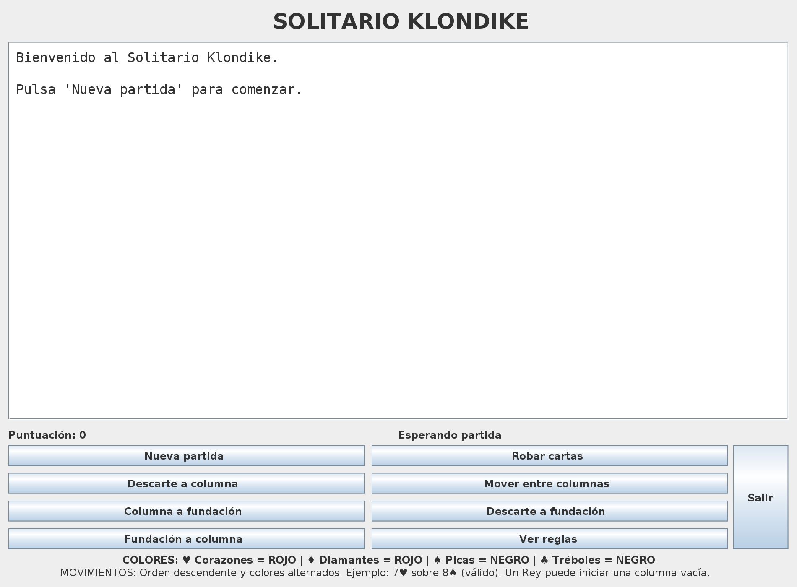
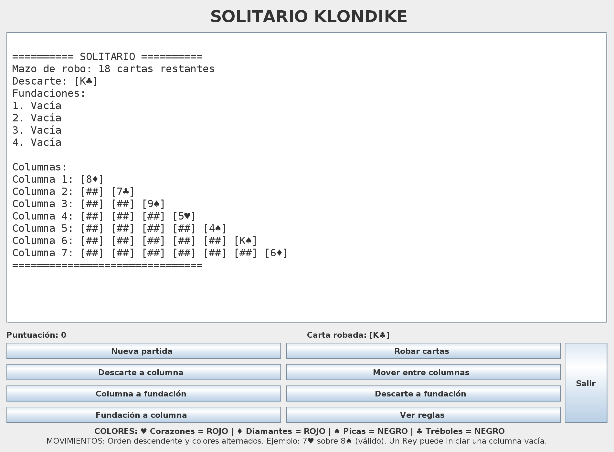
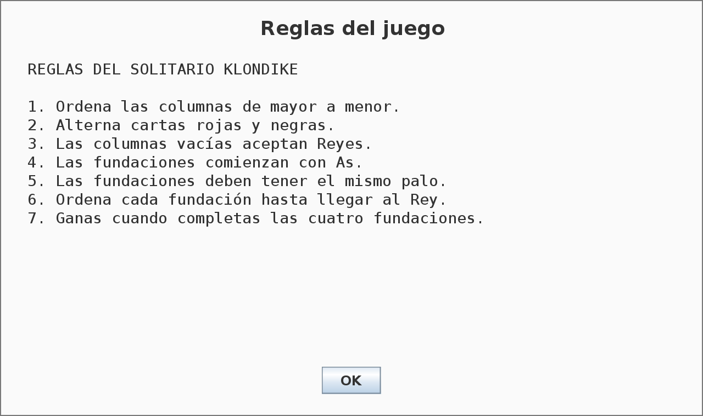

# MANUAL DE USUARIO

## Solitario Klondike

*Desarrollado en Java con interfaz gráfica Swing*

| Campo | Detalle |
|---|---|
| Estudiante | John Anibal Riascos |
| Asignatura | Estructuras de Datos |
| Programa / Institución | ______________________________ |
| Fecha | 20 de noviembre de 2026 |
| Versión | 1.0 |

> Documento elaborado para acompañar la entrega y sustentación del proyecto.

---

## Contenido

- 1. Introducción
  - 1.1 ¿Qué es el Solitario Klondike?
  - 1.2 Objetivo del juego
  - 1.3 Alcance de este manual
  - 1.4 Requisitos
  - 1.5 Instalación y apertura
  - 1.6 Solución de problemas de instalación
- 2. Descripción de la interfaz
  - 2.1 Elementos de la pantalla
  - 2.2 Cómo leer el tablero
  - 2.3 Botones de la interfaz
  - 2.4 Cuadros de diálogo
  - 2.5 Ejemplo de una partida en curso
- 3. Reglas del juego
  - 3.1 Reparto inicial
  - 3.2 Reglas de las columnas
  - 3.3 Reglas de las fundaciones
  - 3.4 Mazo y descarte
  - 3.5 Movimientos permitidos
  - 3.6 Ejemplos de movimientos
  - 3.7 Reglas en pantalla
- 4. Cómo jugar paso a paso
  - 4.1 Iniciar una partida
  - 4.2 Robar cartas
  - 4.3 Mover del descarte a una columna
  - 4.4 Mover una carta o un grupo entre columnas
  - 4.5 Enviar una carta a una fundación
  - 4.6 Devolver una carta de una fundación a una columna
  - 4.7 Ver las reglas y salir
  - 4.8 Puntuación
  - 4.9 Consejos para jugar mejor
- 5. Cómo se gana y cómo se pierde
  - 5.1 Cómo se gana
  - 5.2 Cómo se pierde
  - 5.3 Qué ocurre al terminar
  - 5.4 Resumen de condiciones
- 6. Preguntas frecuentes
  - 6.1 ¿Por qué no puedo mover una carta?
  - 6.2 ¿Por qué el programa pide la posición «desde arriba»?
  - 6.3 ¿Qué significa `[##]`?
  - 6.4 ¿Qué pasa cuando el mazo llega a cero?
  - 6.5 ¿Puedo deshacer un movimiento?
  - 6.6 ¿Puedo arrastrar las cartas con el ratón?
  - 6.7 ¿La puntuación se guarda al cerrar el programa?
  - 6.8 ¿Puedo jugar sin entorno gráfico?
  - 6.9 ¿Cómo reporto un error?
- 7. Limitaciones y recomendaciones
  - 7.1 Limitaciones de esta versión
  - 7.2 Recomendaciones de uso
  - 7.3 Mejoras futuras
- 8. Glosario
- 9. Información del proyecto

---

# 1. Introducción

Este manual explica cómo instalar, abrir y utilizar la aplicación **Solitario Klondike**. El programa permite jugar una partida individual mediante una interfaz gráfica construida con **Java Swing**. La interfaz muestra el estado del tablero y ofrece botones para ejecutar las acciones principales. Para algunas operaciones, el programa solicita datos mediante cuadros de diálogo.

El documento está pensado para una persona que nunca ha usado el programa. Por eso incluye los requisitos, las formas de ejecución, la descripción de cada botón, las reglas, ejemplos de movimientos y la solución de los problemas más frecuentes. Los detalles internos del código se explican en el **Manual Técnico**.

## 1.1 ¿Qué es el Solitario Klondike?

El Solitario Klondike es un juego de cartas para una sola persona. Se juega con una baraja francesa de 52 cartas, organizada en cuatro palos: corazones (♥), diamantes (♦), tréboles (♣) y picas (♠). El objetivo es ordenar todas las cartas en cuatro fundaciones, una por palo, desde el As hasta el Rey.

En esta implementación, el tablero se representa como texto dentro de una ventana. Las cartas tapadas se muestran como **[##]** y las cartas descubiertas con su valor y su símbolo, por ejemplo **[7♥]** o **[K♠]**. El programa no usa imágenes de cartas ni arrastrar y soltar: los movimientos se hacen con botones y con números de columna.

## 1.2 Objetivo del juego

El objetivo es trasladar las **52 cartas** a las cuatro fundaciones. Cada fundación debe contener las 13 cartas de un mismo palo, en orden ascendente: As, 2, 3, ..., 10, J, Q y K. La partida se gana cuando las cuatro fundaciones están completas.

Para conseguirlo, el jugador puede mover cartas entre columnas, robar cartas del mazo, enviar cartas a las fundaciones y devolver cartas de una fundación a una columna cuando el movimiento sea válido.

## 1.3 Alcance de este manual

- **Instalación y apertura:** requisitos, NetBeans, terminal y Maven.
- **Interfaz:** qué muestra la pantalla y para qué sirve cada botón.
- **Reglas:** reparto, columnas, fundaciones, mazo, descarte y movimientos válidos.
- **Juego paso a paso:** cómo iniciar una partida y realizar cada acción.
- **Victoria y derrota:** cuándo termina la partida y qué mensajes aparecen.
- **Solución de problemas:** errores comunes y cómo resolverlos.
- **Preguntas frecuentes, glosario y recomendaciones.**

No se explican aquí las clases, las estructuras de datos ni las pruebas internas. Esa información está en el **Manual Técnico** del proyecto.

## 1.4 Requisitos

| Requisito | Mínimo | Observaciones |
|---|---|---|
| Sistema operativo | Windows, macOS o Linux | Debe tener entorno de escritorio para abrir la ventana. |
| Java | JDK 21 o superior | Probado con JDK 21.0.13 (Temurin). |
| Memoria | 256 MB disponibles | El juego es liviano; no carga imágenes ni recursos externos. |
| Pantalla | Resolución 950 × 700 o superior | La ventana principal mide 950 × 700 píxeles. |
| Librerías externas | Ninguna | Swing y las estructuras propias están incluidas en el proyecto. |
| NetBeans | Recomendado, no obligatorio | También se puede compilar con `javac` o Maven. |

> **Nota.** En el equipo de desarrollo el JDK está en `/home/anibalitho/jdk-21.0.13+9`. Si `java` o `javac` no están en el `PATH`, usa esa ruta o configura las variables de entorno.

## 1.5 Instalación y apertura

### Opción A: NetBeans (recomendada)

1. Abre NetBeans.
2. Selecciona **File → Open Project**.
3. Elige la carpeta `Solitario`, que es la que contiene el archivo `pom.xml`.
4. Espera a que NetBeans termine de cargar el proyecto.
5. Pulsa **Run → Run Project** o la tecla **F6**.

NetBeans compila el proyecto con Maven y abre automáticamente la ventana del juego.

### Opción B: terminal con `javac`

Desde la carpeta del proyecto, compila todas las clases en una carpeta llamada `out` y ejecuta la clase principal:

```text
javac --release 21 -encoding UTF-8 -d out $(find src/main/java -name "*.java")
java -cp out com.mycompany.solitario.Solitario
```

Si el JDK no está en el `PATH`, usa la ruta completa:

```text
JAVA=/home/anibalitho/jdk-21.0.13+9/bin
$JAVA/javac --release 21 -encoding UTF-8 -d out $(find src/main/java -name "*.java")
$JAVA/java -cp out com.mycompany.solitario.Solitario
```

> **Nota.** El comando `find` funciona en Linux y macOS. En Windows es más sencillo usar NetBeans, Maven o compilar los archivos indicando las rutas manualmente.

### Opción C: Maven

Si tienes Maven instalado, puedes generar un jar ejecutable:

```text
mvn clean package
java -jar target/Solitario-1.0-SNAPSHOT.jar
```

El `pom.xml` ya está configurado con Java 21, la codificación UTF-8 y la clase principal `com.mycompany.solitario.Solitario`.

### Cómo abrir el juego después de compilar

- **Desde NetBeans:** pulsa F6 o el botón de ejecución.
- **Desde la terminal con `javac`:** usa el comando de la Opción B de la sección 1.5.
- **Desde el jar de Maven:** ejecuta `java -jar target/Solitario-1.0-SNAPSHOT.jar`.
- **En Windows:** si el jar está asociado a Java, también puedes hacer doble clic sobre él.

## 1.6 Solución de problemas de instalación

| Problema | Causa probable | Solución |
|---|---|---|
| `java: command not found` | Java no está en el `PATH`. | Usa la ruta completa del JDK o agrega su carpeta `bin` al `PATH`. |
| `javac: invalid target release: 21` | El JDK instalado es anterior a 21. | Instala JDK 21 o superior y vuelve a compilar. |
| `UnsupportedClassVersionError` | Se ejecutaron clases compiladas con otra versión de Java. | Borra `out` y `target/classes`, y recompila con JDK 21. |
| `Could not find or load main class` | El classpath o el nombre de la clase no son correctos. | Verifica que estés en la carpeta del proyecto y usa `-cp out`. |
| `HeadlessException` | No hay entorno gráfico disponible. | Abre el juego en una sesión de escritorio; no funciona por SSH sin pantalla. |
| `mvn: command not found` | Maven no está instalado o no está en el `PATH`. | Usa NetBeans o compila con `javac`; Maven es opcional. |

> **Nota.** Si el proyecto se compiló antes con otra versión de Java, pueden quedar clases viejas en `target/classes`. En ese caso ejecuta `mvn clean` o borra la carpeta `out` antes de volver a compilar.

---

# 2. Descripción de la interfaz

Al abrir el programa aparece una ventana titulada **Solitario Klondike**. La pantalla está dividida en tres zonas: el encabezado, el tablero y el panel de acciones. La figura siguiente muestra la pantalla inicial, antes de comenzar una partida.



*Figura 1. Pantalla principal del juego antes de iniciar una partida.*

En la pantalla inicial el tablero muestra un mensaje de bienvenida. Los botones están disponibles, pero las acciones de juego piden primero una partida nueva. La puntuación aparece en cero y el estado indica **Esperando partida**.

## 2.1 Elementos de la pantalla

| Elemento | Ubicación | Función |
|---|---|---|
| **SOLITARIO KLONDIKE** | Parte superior | Título de la aplicación. |
| **Tablero** | Zona central | Muestra el mazo, el descarte, las fundaciones y las siete columnas. |
| **Puntuación** | Debajo del tablero | Puntos acumulados en la partida actual. |
| **Estado** | Debajo del tablero | Mensaje de la última acción o del resultado de la partida. |
| **Botones de acción** | Panel inferior | Nueva partida, robar, mover, fundaciones y reglas. |
| **Ayuda de colores** | Parte inferior | Recuerda qué palos son rojos y cuáles son negros. |
| **Ayuda de movimientos** | Parte inferior | Ejemplo de orden descendente y colores alternados. |
| **Salir** | Lado derecho inferior | Cierra la aplicación. |

## 2.2 Cómo leer el tablero

El tablero se actualiza después de cada acción. Un ejemplo de partida en curso es el siguiente:



*Figura 2. Ejemplo de partida en curso después de robar cartas.*

La información del tablero se organiza así:

- **Mazo de robo:** cantidad de cartas que todavía se pueden robar.
- **Descarte:** carta superior del descarte o la palabra **Vacío**.
- **Fundaciones:** cuatro líneas numeradas del 1 al 4; cada una muestra su carta superior o **Vacía**.
- **Columnas:** siete líneas numeradas del 1 al 7; cada una muestra sus cartas de arriba hacia abajo.

| Representación | Significado | Ejemplo |
|---|---|---|
| `[##]` | Carta tapada; no se puede mover ni consultar su valor. | Una carta oculta en una columna. |
| `[A♥]` | As de corazones descubierto. | Puede iniciar la fundación de corazones. |
| `[10♦]` | Diez de diamantes descubierto. | Puede colocarse sobre un J negro. |
| `[J♣]` | Jota de tréboles descubierta. | Puede colocarse sobre una Q roja. |
| `[Q♠]` | Reina de picas descubierta. | Puede colocarse sobre un K rojo. |
| `[K♥]` | Rey de corazones descubierto. | Puede iniciar una columna vacía. |

Los símbolos de los palos son: **♥ corazones**, **♦ diamantes**, **♣ tréboles** y **♠ picas**. Corazones y diamantes son rojos; tréboles y picas son negros.

## 2.3 Botones de la interfaz

| Botón | Acción | Cuándo usarlo |
|---|---|---|
| **Nueva partida** | Pide el nombre del jugador y reparte una partida nueva. | Al comenzar o después de terminar una partida. |
| **Robar cartas** | Roba hasta tres cartas del mazo y las pasa al descarte. | Cuando necesites cartas nuevas. |
| **Descarte a columna** | Mueve la carta superior del descarte a una columna (1–7). | Si la carta del descarte encaja en una columna. |
| **Mover entre columnas** | Mueve una carta o un grupo de una columna a otra. | Para ordenar columnas o liberar cartas. |
| **Columna a fundación** | Envía la carta superior de una columna a su fundación. | Cuando la carta sea la siguiente de su palo. |
| **Descarte a fundación** | Envía la carta superior del descarte a su fundación. | Cuando la carta del descarte sea la siguiente de su palo. |
| **Fundación a columna** | Devuelve la carta superior de una fundación a una columna. | Si necesitas reutilizar una carta ya subida. |
| **Ver reglas** | Muestra un cuadro con las reglas resumidas. | En cualquier momento. |
| **Salir** | Cierra la aplicación. | Al terminar de jugar. |

## 2.4 Cuadros de diálogo

Las acciones que necesitan datos abren un cuadro de diálogo. Los datos se escriben con el teclado:

- **Nombre del jugador:** texto libre. Si se deja vacío, se usa **Jugador**.
- **Columna:** número entre **1 y 7**. La columna 1 es la primera de la izquierda.
- **Fundación:** número entre **1 y 4**. La fundación 1 es la primera de la izquierda.
- **Posición inicial del grupo:** número entre **1 y el tamaño de la columna**. La posición **1** es la carta superior de la columna; los números aumentan hacia abajo.

> **Nota.** Si cancelas un cuadro de diálogo, la acción se cancela y no se modifica el tablero. Si escribes un número fuera de rango, el programa muestra un mensaje y no realiza el movimiento.

## 2.5 Ejemplo de una partida en curso

En la figura 2 se observa una partida después de robar dos veces. El mazo tiene menos cartas, el descarte muestra la carta superior y las columnas conservan su orden. La puntuación sigue en cero porque todavía no se ha realizado un movimiento que otorgue puntos.

Cada vez que se realiza una acción, el mensaje de estado cambia. Por ejemplo: **Movimiento realizado**, **Movimiento no válido**, **Carta enviada a la fundación** o **Carta robada: [Q♣]**.

---

# 3. Reglas del juego

El Solitario Klondike se juega con una baraja francesa de 52 cartas. Antes de jugar es importante entender el reparto inicial, el papel de las columnas y las fundaciones, y las reglas de movimiento.

## 3.1 Reparto inicial

Al iniciar una partida, el programa mezcla las 52 cartas y las reparte en siete columnas:

- La columna 1 recibe **1 carta**.
- La columna 2 recibe **2 cartas**.
- La columna 3 recibe **3 cartas**.
- La columna 4 recibe **4 cartas**.
- La columna 5 recibe **5 cartas**.
- La columna 6 recibe **6 cartas**.
- La columna 7 recibe **7 cartas**.

En total se reparten **28 cartas**. En cada columna, solo la **última carta** queda descubierta; las demás quedan tapadas. Las **24 cartas restantes** forman el mazo de robo. Al comenzar, el descarte y las cuatro fundaciones están vacíos.

| Zona | Cantidad inicial | Estado inicial |
|---|---|---|
| Columnas | 28 cartas (1+2+3+4+5+6+7) | Solo la última carta de cada columna está descubierta. |
| Mazo de robo | 24 cartas | Preparado para robar de tres en tres. |
| Descarte | 0 cartas | Vacío. |
| Fundaciones | 0 cartas | Las cuatro están vacías. |

## 3.2 Reglas de las columnas

Las columnas se ordenan de **mayor a menor** y con **colores alternados**. La carta que se coloca debe tener un valor inmediatamente menor que la carta sobre la que se apoya y un color distinto.

- Un **7♥** puede colocarse sobre un **8♠** porque 7 es menor que 8 y los colores son distintos.
- Un **7♥** no puede colocarse sobre un **8♥** porque ambos son rojos.
- Un **10♦** puede colocarse sobre un **J♣**.
- Una **columna vacía** solo acepta un **Rey** de cualquier palo.
- Se puede mover una **carta individual** o un **grupo** que ya forme una secuencia válida.

## 3.3 Reglas de las fundaciones

Las fundaciones son cuatro pilas, una por palo. Cada fundación se construye desde el **As** hasta el **Rey**, siempre con el mismo palo:

- La primera carta de una fundación debe ser un **As**.
- La siguiente carta debe ser del **mismo palo** y tener **un valor más**.
- Por ejemplo: **A♦ → 2♦ → 3♦ → ... → K♦**.
- No se puede colocar un **2♥** sobre un **A♦** porque el palo es distinto.
- La fundación se completa cuando llega al **Rey**.

## 3.4 Mazo y descarte

El botón **Robar cartas** toma hasta **tres cartas** del mazo y las coloca en el descarte. La carta superior del descarte es la única que se puede usar para mover a una columna o a una fundación.

Cuando el mazo se queda sin cartas, la siguiente acción de robo recicla el descarte: las cartas vuelven al mazo en orden y se reinicia el recorrido. En esta implementación el reciclaje ocurre automáticamente; no hay un botón separado para reciclar.

> **Nota.** Si el mazo y el descarte están vacíos y no existen movimientos posibles, la partida termina. El mensaje de estado y el cuadro final indican el resultado.

## 3.5 Movimientos permitidos

| Movimiento | Origen | Destino | Condición |
|---|---|---|---|
| Descarte a columna | Carta superior del descarte | Cualquier columna | Orden descendente y color alternado; Rey si la columna está vacía. |
| Columna a columna | Carta o grupo de una columna | Otra columna | El grupo debe ser una secuencia válida y la carta base debe encajar. |
| Columna a fundación | Carta superior de una columna | Fundación de su palo | As si está vacía; mismo palo y valor siguiente si no. |
| Descarte a fundación | Carta superior del descarte | Fundación de su palo | As si está vacía; mismo palo y valor siguiente si no. |
| Fundación a columna | Carta superior de una fundación | Cualquier columna | Debe cumplir la regla de columna. |

## 3.6 Ejemplos de movimientos

| Movimiento | ¿Válido? | Explicación |
|---|---|---|
| `7♥` sobre `8♠` | Sí | 7 es menor que 8 y los colores son distintos. |
| `7♥` sobre `8♥` | No | Los dos son rojos; no se alternan los colores. |
| `K♣` en columna vacía | Sí | Una columna vacía solo acepta un Rey. |
| `Q♦` en columna vacía | No | La columna vacía no acepta una Reina. |
| `A♦` en fundación vacía | Sí | Toda fundación comienza con un As. |
| `2♦` sobre `A♦` | Sí | Mismo palo y valor siguiente. |
| `2♥` sobre `A♦` | No | El palo es distinto. |
| `5♠` sobre `4♠` | No | Falta alternancia de color y el orden de columna es descendente. |

## 3.7 Reglas en pantalla

El botón **Ver reglas** abre un cuadro con un resumen de las reglas. La figura siguiente muestra ese cuadro.



*Figura 3. Cuadro de reglas que se muestra desde el botón «Ver reglas».*

# 4. Cómo jugar paso a paso

Esta sección describe una partida completa desde el inicio. Los números de columna y de fundación siempre empiezan en 1 y se cuentan de izquierda a derecha.

## 4.1 Iniciar una partida

1. Pulsa **Nueva partida**.
2. Escribe el nombre del jugador y pulsa **OK**. Si dejas el campo vacío, se usará **Jugador**.
3. El programa mezcla las cartas, reparte las siete columnas y deja 24 cartas en el mazo.
4. La puntuación se reinicia en **0** y el estado muestra **Nueva partida iniciada. ¡Buena suerte!**.

> **Nota.** Si todavía no has iniciado una partida, cualquier acción de juego muestra el mensaje **Primero debes comenzar una partida**.

## 4.2 Robar cartas

1. Pulsa **Robar cartas**.
2. El programa toma hasta tres cartas del mazo y las coloca en el descarte.
3. La carta superior del descarte queda disponible para moverla.
4. El estado muestra la carta robada, por ejemplo **Carta robada: [Q♣]**.

Si el mazo se agota, la siguiente acción de robo recicla el descarte. El mensaje puede indicar que el mazo se recicló y que puedes volver a robar.

## 4.3 Mover del descarte a una columna

1. Pulsa **Descarte a columna**.
2. Escribe el número de la columna de destino (1 a 7).
3. Si la carta cumple la regla de orden y color, se mueve y el estado muestra **Movimiento realizado**.
4. Si no cumple, el estado muestra **Movimiento no válido** y el tablero no cambia.

## 4.4 Mover una carta o un grupo entre columnas

1. Pulsa **Mover entre columnas**.
2. Escribe la columna de origen (1 a 7).
3. Escribe la posición inicial del grupo. La posición **1** es la carta superior de la columna; los números aumentan hacia abajo.
4. Escribe la columna de destino (1 a 7).
5. Si el grupo es una secuencia válida y la carta base encaja en el destino, el grupo se mueve completo.

Por ejemplo, si la columna 3 tiene `[9♠] [8♥] [7♣]` y quieres mover el `8♥` y el `7♣` a otra columna, la posición inicial es **2**. El grupo se mueve unido; no se mueven cartas sueltas del medio.

> **Nota.** La posición se cuenta desde la carta superior, no desde la base. Si escribes una posición que apunta a una carta tapada o a un grupo que no forma una secuencia válida, el movimiento se rechaza.

## 4.5 Enviar una carta a una fundación

1. Para una carta de una columna, pulsa **Columna a fundación** e indica la columna de origen.
2. Para la carta del descarte, pulsa **Descarte a fundación**.
3. El programa busca la fundación del palo de la carta y comprueba si es el As o la siguiente carta de ese palo.
4. Si el movimiento es válido, la carta desaparece de su origen y aparece en la fundación.

## 4.6 Devolver una carta de una fundación a una columna

1. Pulsa **Fundación a columna**.
2. Escribe el número de la fundación (1 a 4).
3. Escribe la columna de destino (1 a 7).
4. El movimiento solo se realiza si la carta cumple la regla de columna.

Este movimiento resta **5 puntos**, con un mínimo de 0. Úsalo solo cuando realmente necesites la carta para destapar una columna o continuar una secuencia.

## 4.7 Ver las reglas y salir

- **Ver reglas:** abre el cuadro con el resumen de las reglas. Se puede consultar en cualquier momento.
- **Salir:** cierra la aplicación inmediatamente. La puntuación y el ranking en memoria se pierden.

## 4.8 Puntuación

| Acción | Puntos | Observación |
|---|---|---|
| Mover el descarte a una columna | +5 | Solo si el movimiento es válido. |
| Mover una carta o grupo entre columnas | +5 | Solo si el movimiento es válido. |
| Enviar una carta a una fundación | +10 | Desde una columna o desde el descarte. |
| Devolver una carta de una fundación a una columna | −5 | La puntuación nunca baja de 0. |

La puntuación se muestra en la parte inferior de la ventana. El programa también mantiene un ranking de mejores puntajes en memoria, ordenado de mayor a menor; ese ranking se conserva mientras la aplicación sigue abierta.

## 4.9 Consejos para jugar mejor

- **Descubre cartas tapadas:** es la prioridad al principio de la partida.
- **Busca los Ases:** son la base de las fundaciones y conviene subirlos cuanto antes.
- **No muevas cartas sin necesidad:** cada movimiento puede cerrar una opción futura.
- **Usa las columnas vacías para Reyes:** liberan espacio y permiten ordenar grupos largos.
- **Revisa el descarte:** a veces la carta que necesitas ya está disponible.
- **Recicla el mazo:** si no encuentras una jugada, roba hasta agotar el mazo y vuelve a empezar.
- **Consulta las reglas:** el botón **Ver reglas** está siempre disponible.

---

# 5. Cómo se gana y cómo se pierde

## 5.1 Cómo se gana

La partida se gana cuando las **cuatro fundaciones** contienen las **13 cartas** de su palo. En ese momento las 52 cartas están ordenadas y el programa muestra el mensaje **¡Felicidades! Has ganado la partida.**

Al ganar, la puntuación final se registra en el ranking en memoria. El jugador puede iniciar otra partida con el botón **Nueva partida**.

> **Nota.** Para ganar no basta con tener muchas cartas en las fundaciones: deben estar las cuatro completas, desde el As hasta el Rey.

## 5.2 Cómo se pierde

La partida termina cuando **no quedan movimientos posibles** y **no quedan cartas en el mazo ni en el descarte**. El programa muestra un mensaje indicando que no quedan movimientos y que la partida ha terminado.

También puedes cerrar la aplicación con el botón **Salir**; en ese caso la partida no se registra como ganada ni como perdida.

## 5.3 Qué ocurre al terminar

- El estado muestra el resultado de la partida.
- Aparece un cuadro con el resultado y la puntuación final.
- Las acciones de juego se bloquean hasta iniciar una partida nueva.
- La puntuación de una partida ganada se agrega al ranking en memoria.

## 5.4 Resumen de condiciones

| Situación | Resultado | Mensaje o efecto |
|---|---|---|
| Cuatro fundaciones con 13 cartas | Victoria | ¡Felicidades! Has ganado la partida. |
| Sin movimientos y sin cartas por robar | Derrota | No quedan movimientos posibles. La partida ha terminado. |
| El jugador pulsa Salir | Cierre | La aplicación se cierra; no se registra resultado. |
| El jugador inicia otra partida | Reinicio | Se reparte un tablero nuevo y la puntuación vuelve a 0. |

---

# 6. Preguntas frecuentes

## 6.1 ¿Por qué no puedo mover una carta?

Revisa estas causas, en este orden:

- La carta está tapada (`[##]`); primero debes descubrirla.
- El color no se alterna: una carta roja solo puede ir sobre una negra, y viceversa.
- El valor no es el inmediatamente menor: por ejemplo, un 7 solo va sobre un 8.
- La columna de destino está vacía y la carta no es un Rey.
- Estás intentando mover un grupo que no forma una secuencia válida.
- La carta no es la siguiente de la fundación o el palo no coincide.

## 6.2 ¿Por qué el programa pide la posición «desde arriba»?

Porque las columnas se muestran de arriba hacia abajo. La posición **1** es la carta superior de la columna; la posición **2** es la siguiente, y así sucesivamente. Si quieres mover solo la carta superior, escribe **1**.

## 6.3 ¿Qué significa `[##]`?

Es una carta tapada. El programa no muestra su valor ni su palo, y no se puede mover hasta que quede descubierta. Cuando retiras las cartas que están encima, la siguiente carta se descubre automáticamente.

## 6.4 ¿Qué pasa cuando el mazo llega a cero?

En la siguiente acción de robo, el descarte se recicla y vuelve al mazo. El programa reinicia el recorrido circular para que puedas seguir robando. No hay un botón separado para reciclar.

## 6.5 ¿Puedo deshacer un movimiento?

No. Esta versión no incluye la función de deshacer. Si cometes un error, puedes intentar corregirlo con otro movimiento o iniciar una partida nueva.

## 6.6 ¿Puedo arrastrar las cartas con el ratón?

No. La interfaz usa botones y cuadros de diálogo. Las cartas se mueven indicando números de columna, posición y fundación.

## 6.7 ¿La puntuación se guarda al cerrar el programa?

No. La puntuación y el ranking se mantienen en memoria durante la sesión. Al cerrar la aplicación se pierden. Esta es una limitación conocida de la versión académica.

## 6.8 ¿Puedo jugar sin entorno gráfico?

La interfaz principal es Swing y necesita un entorno de escritorio. Si ejecutas el programa por SSH o en una terminal sin pantalla, puede aparecer `HeadlessException`. Para probar las estructuras sin interfaz gráfica puedes ejecutar la clase `PruebaEstructuras` (ver el Manual Técnico).

## 6.9 ¿Cómo reporto un error?

Abre un issue en el repositorio del proyecto: **https://github.com/AnibalRiascos/solitario-klondike/issues**. Incluye los pasos para reproducir el problema, el mensaje de estado y, si es posible, una captura de pantalla.

# 7. Limitaciones y recomendaciones

## 7.1 Limitaciones de esta versión

- No hay arrastrar y soltar: los movimientos se hacen con botones y números.
- No hay función de deshacer ni de rehacer.
- La puntuación y el ranking no se guardan en disco; solo viven en memoria.
- No hay sugerencias automáticas, temporizador ni finalización automática.
- El tablero es textual; no se muestran imágenes de cartas ni animaciones.
- La aplicación está pensada para escritorio, no para navegador ni dispositivos móviles.

## 7.2 Recomendaciones de uso

- Usa NetBeans si no estás familiarizado con la terminal; evita problemas de `PATH` y de classpath.
- Inicia siempre una partida nueva antes de probar los botones de juego.
- Lee el mensaje de estado después de cada acción: indica si el movimiento fue válido.
- Consulta el botón **Ver reglas** si dudas de una jugada.
- Si una acción no funciona, revisa primero el color, el valor y el estado de la carta.
- No cierres la aplicación si quieres conservar la puntuación de la sesión.

## 7.3 Mejoras futuras

Algunas mejoras posibles para próximas versiones son: agregar arrastrar y soltar, guardar el ranking en un archivo, incluir deshacer/rehacer, mostrar sugerencias de movimientos y agregar animaciones. Estas mejoras no forman parte del alcance actual del proyecto.

# 8. Glosario

| Término | Definición |
|---|---|
| **Baraja francesa** | Conjunto de 52 cartas dividido en cuatro palos de 13 cartas cada uno. |
| **Palo** | Familia de la carta: corazones, diamantes, tréboles o picas. |
| **Carta tapada** | Carta cuyo valor y palo no se muestran; se representa como `[##]`. |
| **Carta descubierta** | Carta visible y disponible para jugar. |
| **Columna** | Una de las siete pilas verticales del tablero. |
| **Fundación** | Una de las cuatro pilas donde se ordenan las cartas por palo, del As al Rey. |
| **Mazo de robo** | Pila de cartas de donde se roban hasta tres cartas por turno. |
| **Descarte** | Pila donde se colocan las cartas robadas; solo se usa la carta superior. |
| **Secuencia válida** | Grupo de cartas ordenadas de mayor a menor y con colores alternados. |
| **Reciclar** | Devolver las cartas del descarte al mazo cuando este se agota. |

# 9. Información del proyecto

| Campo | Detalle |
|---|---|
| **Nombre del juego** | Solitario Klondike |
| **Integrante** | John Anibal Riascos |
| **Modalidad** | Proyecto individual |
| **Asignatura** | Estructuras de Datos |
| **Lenguaje** | Java 21 |
| **Interfaz** | Swing (aplicación de escritorio) |
| **Estructuras** | Pila, cola, lista circular, lista doble y árbol binario de búsqueda |
| **Repositorio** | https://github.com/AnibalRiascos/solitario-klondike |
| **Documentación técnica** | Manual_Tecnico_Solitario_Klondike.pdf |

Este manual se complementa con el **Manual Técnico**, que describe la arquitectura, las clases, las estructuras de datos, las pruebas y las decisiones de implementación.


---

*Documento generado para el proyecto Solitario Klondike. John Anibal Riascos — Noviembre de 2026.*
